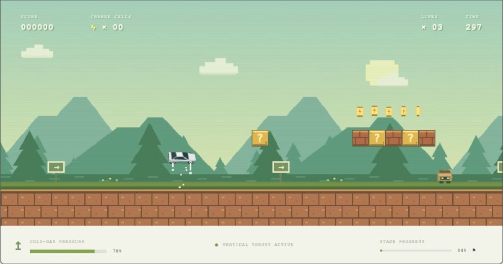

# Tesla Bros.

A browser platformer inspired by the feel of NES Super Mario Bros., starring the Tesla Roadster! With cold-gas jet boost and rocket jumps, speed through where no car has gone before! The first iteration contains **World 1: four original stages**, with original procedural pixel art and synthesized audio.

> **Play the demo:** [tesla.greenzeta.com](https://tesla.greenzeta.com/)



## Play locally

Requires Node.js 18 or newer. There are no dependencies to install.

```sh
npm start
```

Open **http://localhost:5173** and choose **Start Engine**. You can also serve this folder with any static HTTP server. ES modules require HTTP rather than opening `index.html` as a file.

## Controls

| Action | Keyboard |
| --- | --- |
| Drive | ← / → or A / D |
| Jet jump | Space, ↑, or W; hold for more lift |
| Boost | Hold Shift |
| Pause / resume | P or Escape |
| Start / next stage | Enter |
| Restart World 1 | R |
| Toggle sound | M |

Touch controls appear on devices with a coarse pointer. Fullscreen is available through the top-right control when supported by the browser.

The original background tune uses a Commodore SID-inspired three-voice synth: shifting pulse widths, a sawtooth bass, rapid chord arpeggios, ADSR envelopes, and a shared resonant filter. Eight authored sections develop the theme through an answer, lift, quieter bridge, melodic variation, solo, breakdown, and finale, with changing bass patterns, arpeggio directions, and dynamics. The 512-step melody takes roughly 65–77 seconds to repeat, depending on the stage's tempo. Each stage has its own register and filter color. This is a lightweight Web Audio interpretation, not a chip emulator.

The silver, low-profile Roadster performs a full barrel roll around its nose-to-tail axis on each jet jump. A jump releases a short burst of gas. Holding jump extends the burst; landing on any solid surface replenishes pressure. Hit question crates from below to release charge cells or an ion shield. Stomp service bots, collect 50 cells for an extra life, and pass the midpoint flag to set a checkpoint. Reach each stage's Supercharger gate. The final sentinel takes three stomps before the gate opens.

## World 1

1. **Greenline Run** — daylight, charge crates, service bots, chargers, and stairs.
2. **Under the Grid** — a subterranean route with suspended ledges and spikes.
3. **Skyway Sprint** — a sunset course with wider gaps and elevated platforms.
4. **The Giga Fortress** — furnace pits, spikes, and a three-hit sentinel that fires plasma.

Three lives, checkpoint respawns, a per-stage timer, score, and browser-local best scores are included. Reloading begins a new run. Sound preference and best score persist locally when browser storage is available. There are no accounts, analytics, or network requests from the game.

## Development and verification

```sh
npm run check
npm test
```

The Node test suite covers variable jump height, gas recovery, collisions, crate rewards, extra lives, shields, stomping, checkpoints, pause, game over, four-stage progression, the sentinel, full jump rolls and their longitudinal axis, and recorded input routes through every stage's terrain. Terrain replays exclude enemies; enemy and boss interactions have separate tests. Desktop controls, the help dialog, pause/resume, and a 390px mobile layout were also checked in the browser.

- `src/engine.js`: deterministic simulation and authored stages.
- `src/render.js`: Canvas 2D pixel art, backgrounds, and particles.
- `src/roadster.js`: silver Roadster model and longitudinal roll projection.
- `src/game.js`: browser input, UI, audio, and fixed-step game loop.
- `src/music.js`: SID-inspired three-voice background music.
- `src/music-score.js`: eight-section melody, chord progressions, and accompaniment patterns.
- `tests/`: game simulation tests and recorded terrain routes.
- `RESEARCH.md`: Roadster sources and the interpretation used for gameplay.

This is an unofficial fan project and is not affiliated with Tesla or Nintendo. Level layouts and characters are newly authored rather than a tile-for-tile reproduction of Nintendo's stages.
